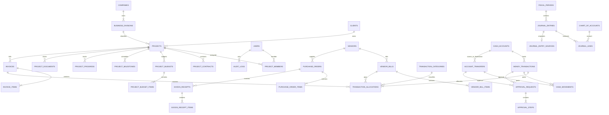

# Phase 1 — Analisis dan Desain Sistem Keuangan

Status: rancangan disetujui; implementasi Phase 2 sedang dimulai.

## 1. Ringkasan kebutuhan

Sistem ini adalah aplikasi internal satu perusahaan untuk mengelola tiga bidang usaha (konstruksi, perizinan, dan interior), proyek, anggaran, pendapatan, biaya, kas/bank, utang/piutang, persetujuan, serta akuntansi berbasis akrual dan double-entry. Browser desktop dan ponsel menjadi kanal utama. Seluruh nilai disimpan dalam IDR.

### Cakupan yang disarankan

- Satu perusahaan dengan tiga bidang usaha yang dapat dikembangkan tanpa memecah database.
- Proyek dan kontrak memiliki riwayat versi; anggaran revisi tidak menimpa versi sebelumnya.
- Invoice, tagihan vendor, pembayaran parsial, alokasi pembayaran, dan jatuh tempo.
- Penerimaan/pengeluaran langsung, pembayaran invoice/tagihan, serta transfer antar-akun.
- Alur draft → submitted → review → approved/revision/rejected → posted.
- Posting membentuk mutasi kas/bank dan jurnal secara atomik. Draft atau transaksi yang belum diposting tidak mengubah saldo.
- Laporan operasional dan keuangan; angka proyek dibedakan antara estimasi, kas, dan laba aktual berbasis jurnal.
- Audit trail, file bukti, RBAC, pembatasan proyek, penguncian periode, dan reversal jurnal.

### Risiko dan celah kebutuhan yang perlu diputuskan

1. **Pengakuan pendapatan:** termin atau penerimaan kas tidak otomatis menjadi pendapatan. Kebijakan pengakuan pendapatan konstruksi/interior harus ditetapkan akuntan; sistem menyediakan jurnal pengakuan terpisah.
2. **Pajak:** jenis pajak, tarif, dasar pengenaan, pemotongan, pembulatan, dan periode efektif belum ditentukan. Tarif harus berupa data berversi, bukan angka tetap di kode.
3. **Persediaan:** pengadaan dan penerimaan barang tercakup, tetapi metode persediaan (perpetual/periodik), gudang, dan valuasi belum ditentukan. Jangan menganggap semua pembelian material langsung menjadi beban.
4. **Persetujuan:** batas nominal, jenis transaksi, pemisahan pembuat dan penyetuju, serta kondisi persetujuan direktur perlu dikonfigurasi.
5. **Anggaran bersama:** perlu kebijakan alokasi overhead perusahaan ke bidang/proyek; jangan membebankan overhead ke proyek tanpa aturan yang disetujui.
6. **Saldo awal dan migrasi:** saldo kas/bank, piutang, utang, aset, dan saldo laba awal harus dimasukkan melalui jurnal pembukaan yang disetujui.
7. **Periode akuntansi:** tahun buku, tanggal tutup, dan siapa yang boleh membuka ulang periode perlu ditetapkan.
8. **Nomor dokumen:** format dan reset nomor invoice, transaksi, PO, serta jurnal belum ditentukan.
9. **Lampiran dan privasi:** batas ukuran, tipe file, retensi, serta akses dokumen sensitif perlu disepakati.
10. **Payroll dan aset tetap:** data karyawan dan aset dapat disimpan, namun payroll tidak termasuk cakupan awal; penyusutan membutuhkan metode, umur manfaat, dan tanggal mulai yang disepakati.

## 2. Arsitektur aplikasi

Gunakan **modular monolith Laravel**: satu aplikasi dan satu database PostgreSQL, tanpa microservices. Ini proporsional untuk 5–10 pengguna, lebih mudah diuji, dan transaksi keuangan dapat dijaga atomik.

```text
Browser desktop/mobile
        │ HTTPS
Laravel (Blade + Livewire + Alpine.js)
        ├── Authentication, Policies, role/permission
        ├── Modul Proyek, Keuangan, Pengadaan, Akuntansi, Laporan
        ├── Application services: approval, posting, allocation, reporting
        ├── Queue/scheduler untuk notifikasi dan pekerjaan terjadwal
        └── PostgreSQL
              ├── master dan dokumen operasional
              ├── ledger kas/bank
              ├── jurnal double-entry
              └── audit trail
```

### Pilihan teknologi dan paket

- Laravel versi stabil yang kompatibel saat proyek dibuat; PHP 8.5 tersedia.
- PostgreSQL 18 sebagai database utama; ekstensi PHP `pdo_pgsql` dan `pgsql` sudah aktif.
- Blade + Livewire, Alpine.js, Tailwind CSS, dan Chart.js; tidak perlu SPA terpisah.
- Autentikasi Laravel; `spatie/laravel-permission` untuk role/permission.
- `brick/math` untuk aritmetika desimal yang akurat; jangan memakai `float` untuk uang.
- Pest untuk unit/feature tests; Laravel Excel dan PDF hanya ditambahkan saat modul ekspor dikerjakan.
- Migrations, Eloquent, Form Requests, Policies, services untuk posting dan aturan keuangan.

### Struktur folder yang disarankan

```text
app/
  Actions/
  Enums/
  Http/
    Controllers/
    Requests/
  Livewire/
  Models/
  Policies/
  Services/
    Accounting/
    Approvals/
    Finance/
    Projects/
  Support/
database/
  factories/
  migrations/
  seeders/
resources/views/
  components/
  layouts/
  livewire/
  pages/
routes/
tests/
  Feature/
  Unit/
```

## 3. Alur bisnis utama

### Pengeluaran proyek dan pembayaran vendor

```text
Permintaan pembelian (opsional)
 → PO disetujui
 → barang/jasa diterima
 → tagihan vendor diverifikasi
 → utang usaha diposting (Dr biaya/persediaan/aset, Cr utang)
 → pembayaran diajukan dan disetujui
 → pembayaran diposting (Dr utang, Cr kas/bank)
 → mutasi akun dan jurnal tersimpan dalam satu transaksi database
```

Pembelian langsung tanpa PO tetap dapat dicatat dengan alasan dan bukti. Penerimaan barang, pengakuan utang, dan pembayaran adalah kejadian berbeda untuk mencegah pencatatan ganda.

### Invoice dan penerimaan pelanggan

```text
Kontrak/termin → invoice diterbitkan → piutang dicatat
 → penerimaan kas/bank → alokasi ke satu atau beberapa invoice
 → sisa piutang dan aging dihitung
 → pengakuan pendapatan dilakukan menurut kebijakan akuntansi terpisah
```

DP pelanggan yang belum memenuhi syarat pengakuan pendapatan dicatat sebagai liabilitas uang muka pelanggan. Pembayaran parsial tidak mengubah nilai kontrak atau mengakui pendapatan secara otomatis.

### Transfer, persetujuan, dan posting

```text
Draft → Submitted → Review → Approved / Revision / Rejected → Posted
```

Transfer antarrekening menghasilkan kredit pada akun asal dan debit pada akun tujuan, bukan pendapatan atau beban. Hanya aksi `post` yang membuat mutasi kas/bank dan jurnal. Dokumen posted tidak dapat diedit/dihapus; koreksi memakai reversal dan dokumen pengganti.

## 4. Use case dan akses

| Peran | Use case utama | Batasan |
|---|---|---|
| Direktur | Dashboard seluruh perusahaan, laporan, persetujuan sesuai limit, pengaturan | Perubahan kebijakan dan pembukaan periode dicatat di audit log |
| Admin keuangan | Master keuangan, invoice, tagihan, pembayaran, kas/bank, review, laporan | Tidak boleh menyetujui transaksi di luar kewenangan |
| Staf keuangan | Input dokumen, pembayaran, bukti, pengajuan | Tidak mem-posting atau menyetujui dokumen sendiri kecuali diizinkan eksplisit |
| Manajer proyek | Proyek yang ditugaskan, progres, RAB, pengajuan biaya | Akses data proyek dibatasi melalui Policy dan assignment |
| Staf proyek | Pengajuan pengeluaran proyek dan bukti | Tidak melihat/mengubah proyek lain |
| Viewer/auditor | Melihat data dan laporan yang diberikan | Tidak dapat mengubah atau menghapus |

Otorisasi wajib diperiksa di server melalui Policies/Gates. Permission menu hanya membantu UX, bukan kontrol keamanan. Akses proyek menggunakan tabel assignment; pembatasan bidang usaha dapat ditambahkan bila diperlukan.

## 5. ERD konseptual



Diagram ini menunjukkan relasi inti; tabel role/permission, pajak, rekonsiliasi, aset tetap, notifikasi, dan pengaturan dirinci di bawah.

## 6. Rancangan database PostgreSQL

### Konvensi

- Semua primary key adalah `BIGINT GENERATED BY DEFAULT AS IDENTITY`; nomor dokumen bisnis memiliki kolom `VARCHAR` dengan `UNIQUE`.
- Uang `NUMERIC(20,2)`, tarif/persentase `NUMERIC(9,4)`, kuantitas `NUMERIC(18,4)`. UI IDR boleh menampilkan tanpa desimal, tetapi pembulatan jurnal harus eksplisit dan konsisten.
- Tanggal bisnis `DATE`; waktu kejadian `TIMESTAMPTZ`; data konfigurasi fleksibel saja memakai `JSONB`.
- Tabel operasional memiliki `created_at`, `updated_at`; dokumen penting juga `created_by`, `updated_by`. FK pengguna menjadi `ON DELETE RESTRICT` atau `SET NULL` sesuai kebutuhan audit.
- Kode master unik per perusahaan. Tambahkan index untuk FK, nomor dokumen, status/tanggal, `due_date`, `project_id`, dan kombinasi filter laporan yang umum.
- Soft delete hanya untuk master yang boleh dinonaktifkan. Dokumen keuangan posted tidak dihapus.

### Perusahaan, pengguna, dan master

| Tabel | Kolom inti (tipe PostgreSQL) | Kunci/aturan utama |
|---|---|---|
| `companies` | `id BIGINT`, `legal_name VARCHAR(200)`, `brand_name VARCHAR(200)`, `tax_number VARCHAR(50)`, `address TEXT`, `currency_code CHAR(3)`, `timezone VARCHAR(64)`, `is_primary BOOLEAN` | PK; unique partial index untuk satu `is_primary = true`; satu perusahaan awal |
| `business_divisions` | `id`, `company_id BIGINT`, `code VARCHAR(20)`, `name VARCHAR(100)`, `is_active BOOLEAN` | FK company; unique `(company_id, code)` |
| `users` | `id`, `name VARCHAR(150)`, `email VARCHAR(255)`, `password VARCHAR(255)`, `is_active BOOLEAN`, `last_login_at TIMESTAMPTZ` | unique email; password hash dari Laravel |
| `roles` | `id`, `name VARCHAR(100)`, `guard_name VARCHAR(50)` | unique `(name, guard_name)` |
| `permissions` | `id`, `name VARCHAR(150)`, `guard_name VARCHAR(50)` | unique `(name, guard_name)` |
| `role_has_permissions` | `permission_id BIGINT`, `role_id BIGINT` | composite PK; FK ke kedua master |
| `model_has_roles` | `role_id BIGINT`, `model_type VARCHAR(255)`, `model_id BIGINT` | composite PK/index model; pivot Spatie |
| `model_has_permissions` | `permission_id BIGINT`, `model_type VARCHAR`, `model_id BIGINT` | composite PK/index model; pivot Spatie |
| `clients` | `id`, `company_id BIGINT`, `code VARCHAR(30)`, `name VARCHAR(200)`, `tax_number VARCHAR(50)`, `email VARCHAR(255)`, `phone VARCHAR(50)`, `address TEXT`, `is_active BOOLEAN` | FK company; unique `(company_id, code)` |
| `vendors` | `id`, `company_id BIGINT`, `code VARCHAR(30)`, `name VARCHAR(200)`, `tax_number VARCHAR(50)`, `email VARCHAR(255)`, `phone VARCHAR(50)`, `address TEXT`, `is_active BOOLEAN` | FK company; unique `(company_id, code)` |
| `employees` | `id`, `company_id BIGINT`, `user_id BIGINT NULL`, `employee_number VARCHAR(30)`, `name VARCHAR(150)`, `division_id BIGINT NULL`, `is_active BOOLEAN` | FK company/user/division; unique `(company_id, employee_number)`; bukan modul payroll |
| `cash_accounts` | `id`, `company_id BIGINT`, `code VARCHAR(30)`, `name VARCHAR(100)`, `account_type VARCHAR(20)`, `bank_name VARCHAR(100) NULL`, `account_number_encrypted TEXT NULL`, `chart_account_id BIGINT`, `is_active BOOLEAN` | FK company/COA; unique `(company_id, code)`; saldo berasal dari ledger, bukan kolom saldo |
| `transaction_categories` | `id`, `company_id BIGINT`, `parent_id BIGINT NULL`, `code VARCHAR(30)`, `name VARCHAR(100)`, `direction VARCHAR(12)`, `income_coa_id BIGINT NULL`, `expense_coa_id BIGINT NULL`, `is_active BOOLEAN` | FK; direction `income/expense`; unique kode per company |
| `units` | `id`, `code VARCHAR(20)`, `name VARCHAR(50)` | unique code; master satuan |
| `tax_rates` | `id`, `code VARCHAR(30)`, `name VARCHAR(100)`, `rate NUMERIC(9,4)`, `valid_from DATE`, `valid_to DATE NULL`, `is_active BOOLEAN` | unique code + periode; tarif tidak ditimpa saat berubah |
| `chart_of_accounts` | `id`, `company_id BIGINT`, `parent_id BIGINT NULL`, `code VARCHAR(30)`, `name VARCHAR(150)`, `account_type VARCHAR(20)`, `normal_balance VARCHAR(6)`, `is_postable BOOLEAN`, `is_active BOOLEAN` | FK; unique `(company_id, code)`; tipe aset/liabilitas/ekuitas/pendapatan/beban |

### Proyek, kontrak, anggaran, dan progres

| Tabel | Kolom inti | Kunci/aturan utama |
|---|---|---|
| `projects` | `id`, `company_id BIGINT`, `division_id BIGINT`, `client_id BIGINT`, `manager_user_id BIGINT NULL`, `code VARCHAR(30)`, `name VARCHAR(200)`, `location TEXT`, `description TEXT`, `start_date DATE`, `target_end_date DATE`, `status VARCHAR(20)` | FK; unique `(company_id, code)`; status terbatas pada planning/active/paused/completed/cancelled |
| `project_members` | `project_id BIGINT`, `user_id BIGINT`, `project_role VARCHAR(30)`, `assigned_at TIMESTAMPTZ` | composite PK; membatasi akses proyek |
| `project_contracts` | `id`, `project_id BIGINT`, `version_no INT`, `contract_number VARCHAR(50)`, `signed_date DATE NULL`, `effective_date DATE`, `contract_value NUMERIC(20,2)`, `file_path TEXT NULL`, `supersedes_id BIGINT NULL` | FK; unique `(project_id, version_no)`; perubahan kontrak berversi |
| `project_budgets` | `id`, `project_id BIGINT`, `revision_no INT`, `status VARCHAR(20)`, `effective_date DATE`, `created_by BIGINT`, `approved_by BIGINT NULL`, `approved_at TIMESTAMPTZ NULL`, `supersedes_id BIGINT NULL` | FK; unique `(project_id, revision_no)`; revisi lama tidak ditimpa |
| `project_budget_items` | `id`, `budget_id BIGINT`, `category_id BIGINT`, `description TEXT`, `quantity NUMERIC(18,4)`, `unit_id BIGINT`, `unit_price NUMERIC(20,2)`, `tax_rate_id BIGINT NULL`, `line_total NUMERIC(20,2)` | FK; total dihitung server-side; kuantitas/harga tidak negatif |
| `project_milestones` | `id`, `project_id BIGINT`, `sequence_no INT`, `name VARCHAR(150)`, `completion_condition TEXT`, `percentage NUMERIC(9,4)`, `amount NUMERIC(20,2)`, `due_date DATE NULL`, `status VARCHAR(20)` | FK; unique `(project_id, sequence_no)`; total persentase/nominal divalidasi terhadap kontrak |
| `project_progress` | `id`, `project_id BIGINT`, `reported_on DATE`, `progress_percent NUMERIC(5,2)`, `description TEXT`, `reported_by BIGINT` | FK; persen 0–100; index `(project_id, reported_on)` |
| `project_documents` | `id`, `project_id BIGINT`, `document_type VARCHAR(30)`, `original_name VARCHAR(255)`, `storage_path TEXT`, `mime_type VARCHAR(100)`, `size_bytes BIGINT`, `uploaded_by BIGINT` | FK; berkas privat, otorisasi sebelum download |

### Invoice, utang, pembayaran, dan pengadaan

| Tabel | Kolom inti | Kunci/aturan utama |
|---|---|---|
| `invoices` | `id`, `company_id BIGINT`, `client_id BIGINT`, `project_id BIGINT NULL`, `milestone_id BIGINT NULL`, `number VARCHAR(40)`, `issue_date DATE`, `due_date DATE`, `status VARCHAR(20)`, `subtotal NUMERIC(20,2)`, `tax_total NUMERIC(20,2)`, `total NUMERIC(20,2)`, `created_by BIGINT` | FK; unique `(company_id, number)`; total disimpan sebagai snapshot dan diverifikasi dari item |
| `invoice_items` | `id`, `invoice_id BIGINT`, `description TEXT`, `quantity NUMERIC(18,4)`, `unit_id BIGINT NULL`, `unit_price NUMERIC(20,2)`, `tax_rate_id BIGINT NULL`, `tax_amount NUMERIC(20,2)`, `line_total NUMERIC(20,2)` | FK; unique/urutan item opsional; tidak menyimpan float |
| `vendor_bills` | `id`, `company_id BIGINT`, `vendor_id BIGINT`, `project_id BIGINT NULL`, `vendor_invoice_number VARCHAR(60)`, `bill_date DATE`, `due_date DATE`, `status VARCHAR(20)`, `subtotal NUMERIC(20,2)`, `tax_total NUMERIC(20,2)`, `total NUMERIC(20,2)` | FK; unique vendor + nomor invoice; status draft/verified/posted/void |
| `vendor_bill_items` | `id`, `vendor_bill_id BIGINT`, `purchase_order_item_id BIGINT NULL`, `goods_receipt_item_id BIGINT NULL`, `category_id BIGINT`, `project_id BIGINT NULL`, `description TEXT`, `quantity NUMERIC(18,4)`, `unit_price NUMERIC(20,2)`, `tax_rate_id BIGINT NULL`, `line_total NUMERIC(20,2)` | FK; referensi penerimaan/PO bila ada |
| `money_transactions` | `id`, `company_id BIGINT`, `cash_account_id BIGINT`, `number VARCHAR(40)`, `direction VARCHAR(12)`, `transaction_date DATE`, `counterparty_client_id BIGINT NULL`, `counterparty_vendor_id BIGINT NULL`, `amount NUMERIC(20,2)`, `status VARCHAR(20)`, `description TEXT`, `created_by BIGINT`, `posted_at TIMESTAMPTZ NULL` | FK; unique nomor; direction receipt/disbursement; saldo berubah hanya saat posted |
| `transaction_allocations` | `id`, `money_transaction_id BIGINT`, `invoice_id BIGINT NULL`, `vendor_bill_id BIGINT NULL`, `category_id BIGINT NULL`, `project_id BIGINT NULL`, `division_id BIGINT NULL`, `amount NUMERIC(20,2)`, `tax_rate_id BIGINT NULL` | FK; CHECK tepat satu target invoice/tagihan/kategori; jumlah alokasi harus sama dengan header saat posting |
| `account_transfers` | `id`, `company_id BIGINT`, `number VARCHAR(40)`, `from_account_id BIGINT`, `to_account_id BIGINT`, `transfer_date DATE`, `amount NUMERIC(20,2)`, `status VARCHAR(20)`, `created_by BIGINT`, `posted_at TIMESTAMPTZ NULL` | FK; akun asal ≠ tujuan; unique nomor; transfer bukan income/expense |
| `cash_movements` | `id`, `cash_account_id BIGINT`, `movement_date DATE`, `direction VARCHAR(6)`, `amount NUMERIC(20,2)`, `money_transaction_id BIGINT NULL`, `account_transfer_id BIGINT NULL`, `created_at TIMESTAMPTZ` | FK; CHECK tepat satu sumber; immutable; unique sumber + arah |
| `approval_requests` | `id`, `money_transaction_id BIGINT NULL`, `account_transfer_id BIGINT NULL`, `purchase_order_id BIGINT NULL`, `requested_by BIGINT`, `status VARCHAR(20)`, `submitted_at TIMESTAMPTZ`, `completed_at TIMESTAMPTZ NULL` | FK; CHECK tepat satu dokumen; index status/tanggal |
| `approval_steps` | `id`, `approval_request_id BIGINT`, `step_no INT`, `approver_role_id BIGINT NULL`, `approver_user_id BIGINT NULL`, `decision VARCHAR(20) NULL`, `comment TEXT NULL`, `decided_at TIMESTAMPTZ NULL` | FK; unique `(approval_request_id, step_no)`; pemisahan pengaju/penyetuju |
| `purchase_orders` | `id`, `company_id BIGINT`, `vendor_id BIGINT`, `project_id BIGINT NULL`, `number VARCHAR(40)`, `order_date DATE`, `status VARCHAR(20)`, `total NUMERIC(20,2)`, `created_by BIGINT` | FK; unique nomor; persetujuan sebelum komitmen |
| `purchase_order_items` | `id`, `purchase_order_id BIGINT`, `description TEXT`, `quantity NUMERIC(18,4)`, `unit_id BIGINT`, `unit_price NUMERIC(20,2)`, `project_id BIGINT NULL`, `line_total NUMERIC(20,2)` | FK; item PO |
| `goods_receipts` | `id`, `purchase_order_id BIGINT`, `receipt_number VARCHAR(40)`, `received_at TIMESTAMPTZ`, `received_by BIGINT`, `notes TEXT NULL` | FK; unique receipt number |
| `goods_receipt_items` | `id`, `goods_receipt_id BIGINT`, `purchase_order_item_id BIGINT`, `quantity_received NUMERIC(18,4)`, `notes TEXT NULL` | FK; kuantitas kumulatif tidak melebihi PO kecuali ada persetujuan |

### Akuntansi, rekonsiliasi, aset, dan sistem

| Tabel | Kolom inti | Kunci/aturan utama |
|---|---|---|
| `fiscal_periods` | `id`, `company_id BIGINT`, `name VARCHAR(50)`, `starts_on DATE`, `ends_on DATE`, `status VARCHAR(12)`, `closed_by BIGINT NULL`, `closed_at TIMESTAMPTZ NULL` | FK; unique periode; tanggal tidak tumpang tindih; periode closed menolak posting |
| `journal_entries` | `id`, `company_id BIGINT`, `fiscal_period_id BIGINT`, `number VARCHAR(40)`, `entry_date DATE`, `description TEXT`, `status VARCHAR(12)`, `created_by BIGINT`, `posted_by BIGINT NULL`, `posted_at TIMESTAMPTZ NULL` | FK; unique nomor; jurnal posted immutable |
| `journal_lines` | `id`, `journal_entry_id BIGINT`, `line_no INT`, `chart_account_id BIGINT`, `cash_account_id BIGINT NULL`, `division_id BIGINT NULL`, `project_id BIGINT NULL`, `description TEXT NULL`, `debit NUMERIC(20,2)`, `credit NUMERIC(20,2)` | FK; debit/credit ≥ 0 dan tepat satu bernilai positif; unique `(journal_entry_id, line_no)` |
| `journal_entry_sources` | `journal_entry_id BIGINT`, `invoice_id BIGINT NULL`, `vendor_bill_id BIGINT NULL`, `money_transaction_id BIGINT NULL`, `account_transfer_id BIGINT NULL`, `depreciation_entry_id BIGINT NULL` | PK/FK journal; CHECK tepat satu sumber; unique setiap sumber untuk idempotensi |
| `account_mappings` | `id`, `company_id BIGINT`, `event_code VARCHAR(40)`, `account_role VARCHAR(30)`, `chart_account_id BIGINT`, `effective_from DATE`, `effective_to DATE NULL` | FK; unique event/role/awal efektif; pemetaan akun berversi |
| `journal_reversals` | `original_entry_id BIGINT`, `reversal_entry_id BIGINT`, `reason TEXT`, `reversed_by BIGINT`, `reversed_at TIMESTAMPTZ` | PK original; kedua FK journal; unique reversal; tidak menghapus jurnal |
| `bank_reconciliations` | `id`, `cash_account_id BIGINT`, `period_start DATE`, `period_end DATE`, `statement_ending_balance NUMERIC(20,2)`, `status VARCHAR(12)`, `reconciled_by BIGINT NULL`, `reconciled_at TIMESTAMPTZ NULL` | FK; unique account/periode; hanya akun bank |
| `bank_reconciliation_items` | `id`, `bank_reconciliation_id BIGINT`, `cash_movement_id BIGINT NULL`, `statement_date DATE`, `statement_amount NUMERIC(20,2)`, `reference VARCHAR(100) NULL`, `matched_at TIMESTAMPTZ NULL` | FK; item yang cocok menunjuk mutasi ledger |
| `fixed_assets` | `id`, `company_id BIGINT`, `asset_code VARCHAR(30)`, `name VARCHAR(150)`, `acquired_on DATE`, `cost NUMERIC(20,2)`, `residual_value NUMERIC(20,2)`, `useful_life_months INT`, `depreciation_method VARCHAR(20)`, `status VARCHAR(20)` | FK; unique kode; metode dan masa manfaat perlu validasi kebijakan |
| `depreciation_entries` | `id`, `fixed_asset_id BIGINT`, `fiscal_period_id BIGINT`, `journal_entry_id BIGINT NULL`, `amount NUMERIC(20,2)`, `posted_at TIMESTAMPTZ NULL` | FK; unique aset/periode; jurnal tidak dibuat ganda |
| `audit_logs` | `id`, `user_id BIGINT NULL`, `action VARCHAR(50)`, `entity_type VARCHAR(100)`, `entity_id BIGINT`, `before_data JSONB NULL`, `after_data JSONB NULL`, `request_id VARCHAR(80) NULL`, `ip_address INET NULL`, `created_at TIMESTAMPTZ` | append-only melalui aplikasi; index entity/user/timestamp |
| `settings` | `id`, `company_id BIGINT`, `key VARCHAR(100)`, `value JSONB`, `updated_by BIGINT` | FK; unique `(company_id, key)` |
| `notifications` | Skema notifikasi Laravel: `id UUID`, `type VARCHAR(255)`, `notifiable_type VARCHAR(255)`, `notifiable_id BIGINT`, `data JSONB`, `read_at TIMESTAMPTZ NULL` | Index notifiable + read_at |

### Constraint dan indeks tambahan

- Unique `(company_id, document_number)` untuk invoice, transaksi, transfer, PO, dan jurnal.
- Index `(status, transaction_date)`, `(project_id, transaction_date)`, `(client_id, due_date)`, `(vendor_id, due_date)`, serta FK semua tabel detail.
- CHECK nilai uang/kuantitas non-negatif; rekening transfer berbeda; tarif pajak pada rentang yang diizinkan.
- `journal_lines` memiliki CHECK debit/credit per baris; keseimbangan total debit=kredit divalidasi ketika posting di dalam transaksi database. Tambahkan deferred PostgreSQL constraint trigger bila disetujui agar invariant tetap dijaga walau ada jalur tulis di luar service.
- Saldo kas/bank, piutang, utang, dan laporan keuangan dihitung dari transaksi/jurnal posted; cache laporan boleh ditambah kemudian, bukan sumber kebenaran.
- Foreign key dokumen sumber pada `journal_entry_sources` menjaga referensial integrity; tidak memakai satu kolom polymorphic `source_id` tanpa FK.

### Alasan desain

1. Satu ledger transaksi dan jurnal menjadi sumber data laporan; saldo tidak diedit langsung.
2. Header/detail memisahkan dokumen dan rincian; satu pembayaran dapat dialokasikan ke beberapa invoice/tagihan.
3. Revisi anggaran/kontrak disimpan sebagai versi, sehingga rencana awal dan revisi dapat dibandingkan.
4. Transfer memakai entitas tersendiri, mencegahnya masuk laporan pendapatan/beban.
5. `NUMERIC` menghindari error floating point; jurnal membawa dimensi bidang usaha/proyek.
6. Dokumen sumber jurnal menggunakan FK nyata, mendukung audit dan pencegahan posting ganda.
7. Satu database dan modular monolith menjaga konsistensi transaksi serta mengurangi beban operasional.

## 7. Rancangan UI

Sidebar: Dashboard; Master Data; Operasional (Proyek, RAB, Pengadaan, Progres); Keuangan (Kas Masuk/Keluar, Invoice, Pembayaran, Utang/Piutang, Transfer); Akuntansi; Laporan; Pengaturan.

- Dashboard difilter periode, bidang usaha, dan proyek sesuai akses user.
- Tabel memiliki pencarian, filter, pagination, status, serta ekspor sesuai permission.
- Form transaksi menampilkan proyek/bidang/kategori, sumber dana, pajak, alokasi, bukti, dan status approval.
- Halaman detail proyek memiliki tab informasi, kontrak, RAB, realisasi, invoice, pembayaran, progres, dokumen, dan laba.
- UI berbahasa Indonesia; tanggal `DD-MM-YYYY`; IDR diformat `Rp1.000.000`; state loading, empty, berhasil, gagal, konfirmasi, dan validasi ditampilkan jelas.
- Bukti transaksi disimpan private; jangan menggunakan URL publik permanen.

## 8. Roadmap implementasi

1. **Phase 1 (dokumen ini):** finalisasi keputusan bisnis, ERD, role, UI, dan persetujuan desain.
2. **Phase 2:** Laravel project, konfigurasi PostgreSQL, migrations, model/relasi, auth/RBAC, master, layout; review dan test.
3. **Phase 3:** transaksi kas/bank, approval, lampiran, audit, posting dan jurnal; invariants diuji.
4. **Phase 4:** proyek, kontrak, revisi RAB, progres, biaya aktual.
5. **Phase 5:** invoice/DP/termin, utang vendor, payment allocation, procurement, aging.
6. **Phase 6:** COA, pemetaan jurnal, buku besar, laporan keuangan, aset, penguncian periode.
7. **Phase 7:** dashboard, laporan per proyek/bidang, PDF/Excel/CSV.
8. **Phase 8:** security, UAT akuntan, backup/restore, beban multiuser, deployment.

Urutan dapat mengembangkan proyek dan master lebih awal bila dibutuhkan untuk menguji skenario end-to-end, tetapi tidak melewati persetujuan desain database sebelum migration.

## 9. Rencana pengujian

| Area | Pengujian inti |
|---|---|
| Arsitektur/akses | Login, rate limit, role/permission, batas data proyek, akses lampiran tanpa izin |
| Master/proyek | Kode unik, status, assignment, kontrak dan RAB berversi, soft delete master |
| Keuangan | Alokasi parsial/penuh, saldo sebelum/sesudah post, transaksi draft tidak mengubah saldo, idempotensi post |
| Transfer | Dua mutasi kas yang seimbang; tidak masuk pendapatan/beban |
| Approval | Batas nominal, pemisahan pengaju/penyetuju, revisi/penolakan, urutan approval |
| Akuntansi | Debit=credit, posting invoice/tagihan/pembayaran/DP, reversal, periode terkunci, tidak ada duplikasi jurnal |
| Laporan | Rekonsiliasi saldo ke ledger, aging, filter bidang/proyek/periode, laba aktual vs estimasi |
| Data | Decimal tidak memakai float, FK/check/unique, transaksi rollback saat posting gagal |
| Operasional | Upload berkas, backup/restore, responsive desktop/mobile, notifikasi dan ekspor |

## 10. Persetujuan dan keputusan

Desain disetujui untuk memulai fondasi Phase 2. Keputusan yang sudah diberikan:

- Pengakuan pendapatan ditunda sampai kebijakan akuntansi perusahaan ditetapkan; sistem tidak mengotomatisasi pengakuan pendapatan pada tahap awal.
- Persediaan/gudang tidak masuk MVP; PO dan penerimaan barang tetap dapat dikembangkan tanpa valuasi stok.
- Nomor dokumen dibuat otomatis. Prefix awal dapat digunakan dahulu dan nantinya dikonfigurasi manual melalui pengaturan.

Sebelum posting transaksi keuangan produksi, hal berikut tetap perlu disetujui:

1. Metode pengakuan pendapatan untuk konstruksi/interior dan pencatatan DP.
2. Pajak yang digunakan beserta aturan pembulatan dan pemotongan.
3. Persetujuan nominal/jenis transaksi dan aturan pembuat tidak menyetujui sendiri.
4. Apakah persediaan/gudang dan payroll masuk ruang lingkup awal.
5. Tahun buku, saldo awal, format nomor dokumen, dan kebijakan pembukaan periode.

Fondasi Phase 2 menggunakan migration inti, authentication tertutup, RBAC, setup perusahaan, dan sequence nomor dokumen. Modul transaksi, posting jurnal, serta keputusan akuntansi tetap menunggu fase berikutnya.
